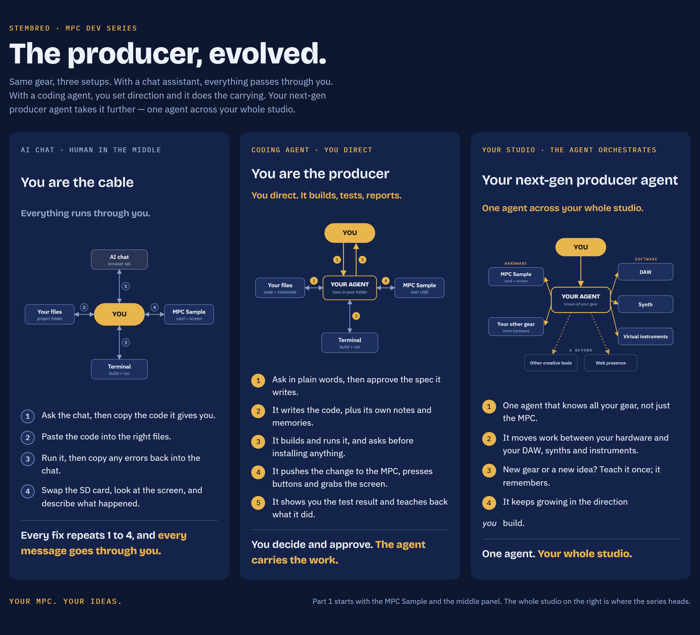

# Next-Gen Producer Agent

**Start your next-gen producer agent today, starting with Akai's newly opened-up MPC lineup.**
Build your own coding agent that's an expert on *your* MPC.

This is the starter kit for the StemBred series *Hello World: Make Your Own MPC Mods*. You set up a coding agent, teach it about your Akai MPC Sample, and then make the MPC do new things together, one small feature at a time, in plain language.

## ⬇️ Step 1: get `seed.md`
**[Open seed.md](seed.md)**, then click the **Download raw file** button (the ⬇ icon at the top right of the file).
Save it into your project folder (see *Set up* below). That one file is all you need from this repo.



## The idea
- **You describe, your agent builds.** You say what you want in your own words. Your agent writes a short spec, you approve it, then it builds and tests it.
- **Layer by layer, like a beat.** Part 1 of the series makes small changes to the MPC's **stock** software, so you learn the pattern and build confidence. A reboot always brings back stock.
- **Your agent grows with you.** Its rules, memories and features live in your project folder. Every session picks up where the last one stopped.
- **Open prompt, roll your own.** Copy what we typed if you get stuck, but the goal is that you build *your* ideas.

## Before you start
1. **Claude Code**, installed and signed in (Claude Pro or higher): [Claude Code quickstart](https://code.claude.com/docs/en/quickstart)
2. **A synced folder for backups**, for example Google Drive for desktop: [Use Google Drive for desktop](https://support.google.com/drive/answer/10838124)
3. **Akai's official files** from [Akai's MPC Sample downloads page](https://www.akaipro.com/downloads-and-support/downloads/?product=MPC%20Sample): the **MPC Sample user guide** (PDF) and the **MPC Sample firmware updater**. Your agent only *reads* the updater. Never run it as part of this series.
4. **An MPC Sample**, a **USB-C data cable** (charge-only cables won't work), and a **spare SD card you can erase**.
5. **[`seed.md`](seed.md)** from this repo (see Step 1 above).

## Set up (2 minutes)
```
My-MPC-Agent/          ← one folder, inside your synced folder
├─ seed.md             ← from this repo
└─ inputs/
    ├─ MPC Sample user guide (PDF)
    └─ MPC Sample firmware updater
```
Open a terminal in `My-MPC-Agent`, start Claude Code (`claude`), and type something like:

> Read seed.md. You're my MPC agent now. Set yourself up.

From there, follow the videos. Your agent builds out the rest of the folder with you.

## Community resources
- [open-mpc](https://github.com/open-mpc): a community open-source (MIT) project documenting how MPC devices work, the MPC Sample included. It's a helpful map, not official, so your agent checks its claims.

## Safety
- Filmed on MPC Sample firmware **1.3.x**. Don't update your firmware for this series; updates get their own episode.
- Our changes run from the SD card and from memory. Power off and remove the card, and the MPC boots stock.
- Back up your projects and your card before experimenting. You use this at your own risk.

---
StemBred is an independent creator. This project is **not affiliated with, endorsed by, or supported by Akai Professional or inMusic.** MPC and MPC Sample are trademarks of their respective owners.

License: [MIT](LICENSE)
