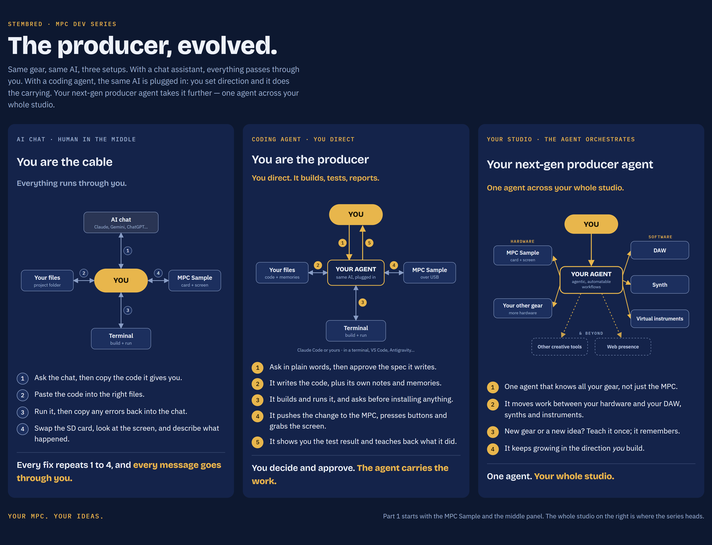
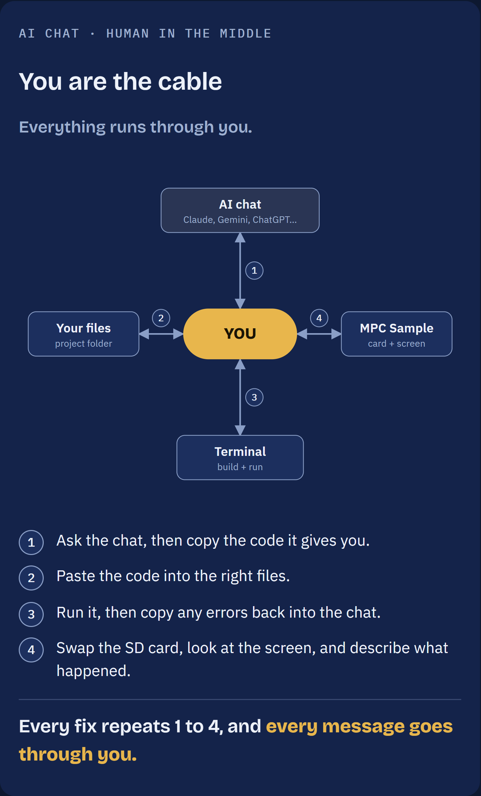
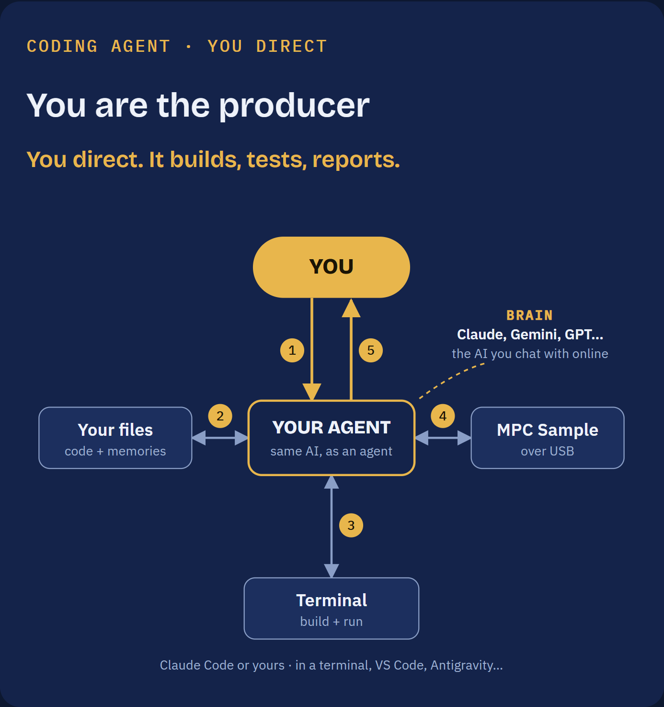
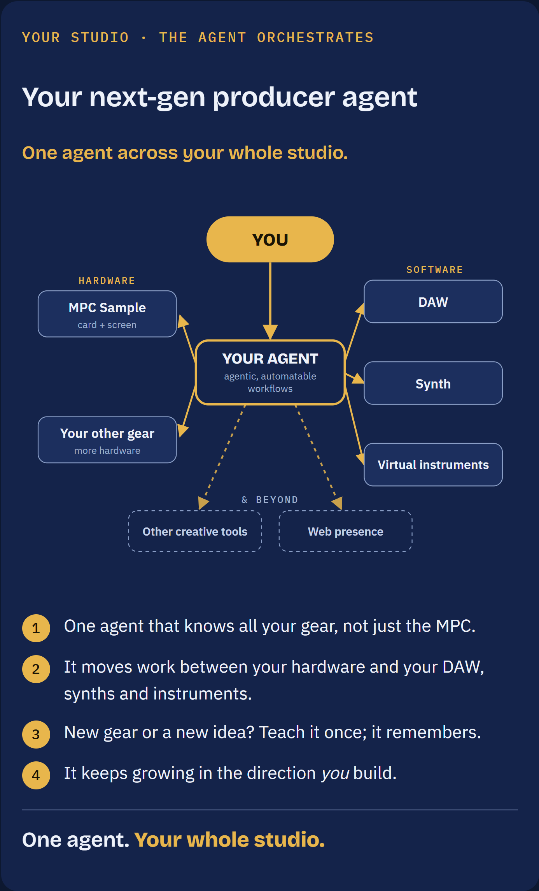
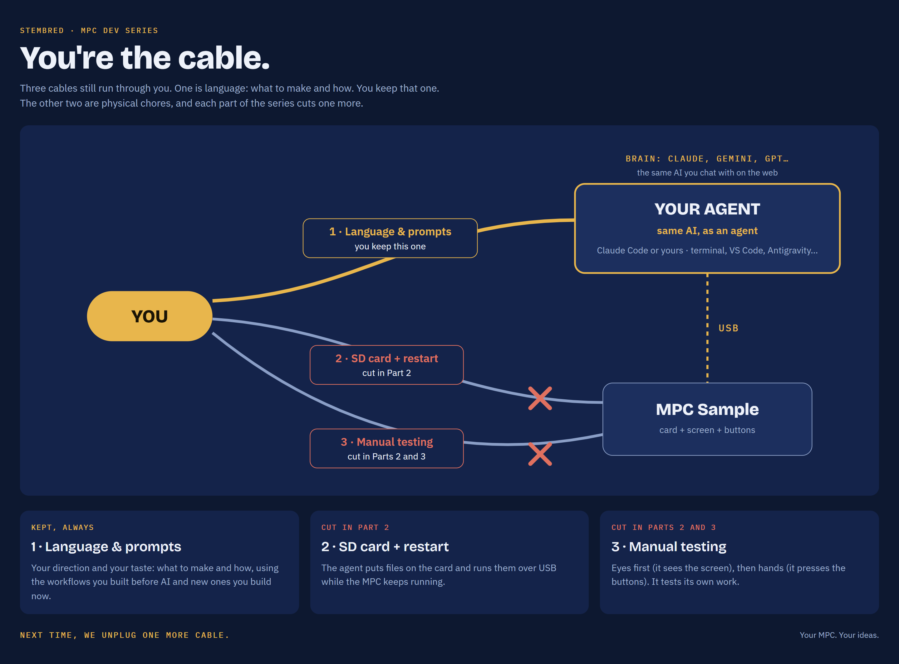

# Next-Gen Producer Agent

**Start your next-gen producer agent today, starting with Akai's newly opened-up MPC lineup.**
Build your own coding agent that's an expert on *your* MPC.

This is the starter kit for the StemBred series *Hello World: Make Your Own MPC Mods*. You set up a coding agent, teach it about your Akai MPC Sample, and then make the MPC do new things together, one small feature at a time, in plain language.

## 📺 Start with the videos
The video series is the place to start: it walks you through putting all the pieces together, step by step.
- **Part 1: Set up your agent from scratch**: *video link coming soon*

New here from a video? Welcome. Everything the videos ask you to grab is below.

## ⬇️ Step 1: get `seed.md`
**[Open seed.md](seed.md)**, then click the **Download raw file** button (the ⬇ icon at the top right of the file).
Save it into your project folder (see *Set up* below). Do the same with **[mpc-sample-proven.md](mpc-sample-proven.md)**, but put that one in your `inputs` folder. It's what our agent already proved on the MPC Sample, so yours doesn't start from zero.

[](https://raw.githubusercontent.com/StemBred/next-gen-producer-agent/main/images/chat-vs-agent.png)

<sub>↑ Click the picture to open it full size. Each setup is also below, one at a time, so it's easier to read.</sub>

<details>
<summary><b>The three setups, one at a time</b> (click to open)</summary>

#### 1. AI chat: you are the cable



1. Ask the chat, then copy the code it gives you.
2. Paste the code into the right files.
3. Run it, then copy any errors back into the chat.
4. Swap the SD card, look at the screen, and describe what happened.

Every fix repeats 1 to 4, and **every message goes through you.**

#### 2. Coding agent: you are the producer



1. Ask in plain words, then approve the spec it writes.
2. It writes the code, plus its own notes and memories.
3. It builds and runs it, and asks before installing anything.
4. It pushes the change to the MPC, presses buttons and grabs the screen.
5. It shows you the test result and teaches back what it did.

You decide and approve. **The agent carries the work.**

#### 3. Your studio: your next-gen producer agent



1. One agent that knows all your gear, not just the MPC.
2. It moves work between your hardware and your DAW, synths and instruments.
3. New gear or a new idea? Teach it once; it remembers.
4. It keeps growing in the direction *you* build.

One agent. **Your whole studio.**

</details>

### You're the cable
Three cables still run through you. Each part of the series unplugs one more.

[](https://raw.githubusercontent.com/StemBred/next-gen-producer-agent/main/images/three-cables.png)

## The idea
- **You describe, your agent builds.** You say what you want in your own words. Your agent writes a short spec, you approve it, then it builds and tests it.
- **Layer by layer, like a beat.** Part 1 of the series makes small changes to the MPC's **stock** software, so you learn the pattern and build confidence. A reboot always brings back stock.
- **Your agent grows with you.** Its rules, memories and features live in your project folder. Every session picks up where the last one stopped.
- **Open prompt, roll your own.** Copy what we typed if you get stuck, but the goal is that you build *your* ideas.

## Before you start
1. **Claude Code**, installed and signed in (Claude Pro or higher): [Claude Code quickstart](https://code.claude.com/docs/en/quickstart)
2. **A synced folder for backups**, for example Google Drive for desktop: [Use Google Drive for desktop](https://support.google.com/drive/answer/10838124)
3. **Akai's official files** from [Akai's MPC Sample downloads page](https://www.akaipro.com/downloads-and-support/downloads/?product=MPC%20Sample): the **MPC Sample user guide** (PDF) and the **MPC Sample firmware updater**. Your agent only *reads* the updater. Never run it as part of this series.
4. **An MPC Sample**, a **USB-C data cable** (charge-only cables won't work), and a **spare SD card you can erase**.
5. **[`seed.md`](seed.md)** from this repo (see Step 1 above).

## Set up (2 minutes)
```
My-MPC-Agent/          ← one folder, inside your synced folder
├─ seed.md             ← from this repo
└─ inputs/
    ├─ MPC Sample user guide (PDF)
    ├─ MPC Sample firmware updater
    └─ mpc-sample-proven.md   ← from this repo: what our agent already proved
```
Plug your MPC into the computer with the USB-C data cable and power it on, on its normal screen (**not in SD Card mode**). Then open a terminal in `My-MPC-Agent`, start Claude Code (`claude`), and type something like:

> Read seed.md. You're my MPC agent now. Set yourself up.

From there, follow along with the [videos](#-start-with-the-videos). Your agent builds out the rest of the folder with you.

**The prompts we type in the videos are in [prompts.md](prompts.md),** so you can copy them if you get stuck. Saying it in your own words works too.

## Community resources
- [open-mpc](https://github.com/open-mpc): a community open-source (MIT) project documenting how MPC devices work, the MPC Sample included. It's a helpful map, not official, so your agent checks its claims.

## Safety
- Filmed on MPC Sample firmware **1.3.x**. Don't update your firmware for this series; updates get their own episode.
- Our changes run from the SD card and from memory. Power off and remove the card, and the MPC boots stock.
- Back up your projects and your card before experimenting. You use this at your own risk.

---
StemBred is an independent creator. This project is **not affiliated with, endorsed by, or supported by Akai Professional or inMusic.** MPC and MPC Sample are trademarks of their respective owners.

License: [MIT](LICENSE)
